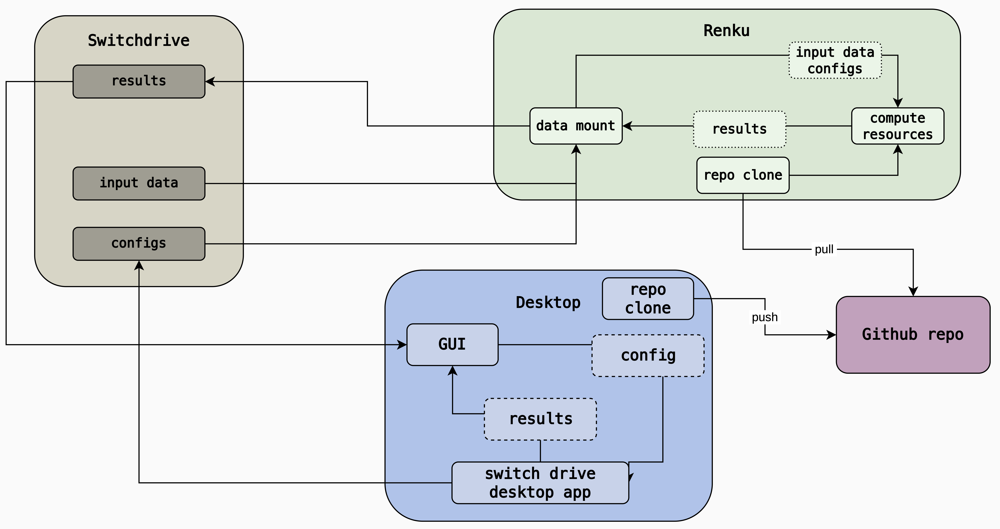

# Guiding Generative Probabilistic Weather Models

Code and interactive notebooks for experiments on guiding generative probabilistic weather models.

[Presentation (PDF)](resources/presentation.pdf)

## Repository structure

This project starts from the [Geoarches source repository](https://github.com/INRIA/geoarches), with ArchesWeather and ArchesWeatherGen as the forecasting backbone. We added `geoarches/lightning_modules/guided_diffusion.py` for gradient-based guidance (`FGWNOLR`) and developed the experiment configuration, rollout runner, and analysis notebooks in `src/`.

## Analysis notebooks

Launch a notebook from the repository root:

```bash
uv run marimo edit src/ui/guidance.py --watch --no-token
uv run marimo edit src/ui/flow_time_tests.py --watch --no-token
uv run marimo edit src/ui/experiment_builder.py --watch --no-token
```

## Experiments

Create an experiment in the experiment builder, then use its rollout ID to download the input data and run a guided rollout:

```bash
python -m src.download --rollout_id <rollout_id>
python -m src.run --rollout_id <rollout_id> --rollout_type gui
```

Replace `<rollout_id>` with the experiment ID. Use `--rollout_type ung` for an unguided rollout.

## Environment setup

Install the dependencies from the repository root:

```bash
uv sync
```

Follow the [Geoarches setup guide](https://geoarches.readthedocs.io/en/latest/archesweather/setup/) for pretrained model downloads and statistics, and its [installation guide](https://geoarches.readthedocs.io/en/latest/getting_started/installation/#downloading-data) for data downloads. Place the files in the layout below; `data/` can be a symlink to shared storage.

```text
data/
├── modelstore/
│   ├── archesweather-m-seed0/
│   ├── archesweather-m-seed1/
│   ├── archesweather-m-skip-seed0/
│   ├── archesweather-m-skip-seed1/
│   └── archesweathergen/
│       ├── config.yaml
│       └── checkpoints/checkpoint.ckpt
├── stats/
│   ├── pangu_norm_stats2_with_w.pt
│   ├── deltapred24_aws_denorm.pt
│   ├── archesweather_constant_masks.pt
│   ├── delta24_stats.pt
│   ├── delta24_stats_with_w.pt
│   ├── pangu_norm_stats2.pt
│   ├── dcpp_spatial_norm_stats.pt
│   ├── climatology_metrics.pt
│   ├── era5-quantiles-2016_2022.nc
│   └── era5_240_clim.nc
└── era5/
    └── <ERA5 NetCDF files>
```

Each model directory contains its own `config.yaml` and `checkpoints/checkpoint.ckpt`. The statistics listed above mirror our local setup; guided inference uses `pangu_norm_stats2_with_w.pt`, `deltapred24_aws_denorm.pt`, and `archesweather_constant_masks.pt`, while the remaining files support other model and evaluation workflows.



On Renku, run once after creating a session:

```bash
cd guiding-generative-probabilistic-weather-models
ln -s ../data data
mkdir -p modelstore stats
cp -r data/modelstore/* modelstore/
cp -r data/stats/* stats/
```

Locally, link your data directory (adjust the path as needed):

```bash
ln -s ~/switchdrive data
```

Both model loading and normalization prefer repository-root `modelstore/` and `stats/` copies when present, falling back to `data/` otherwise.
